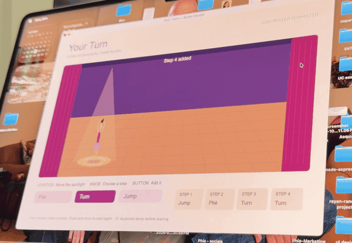
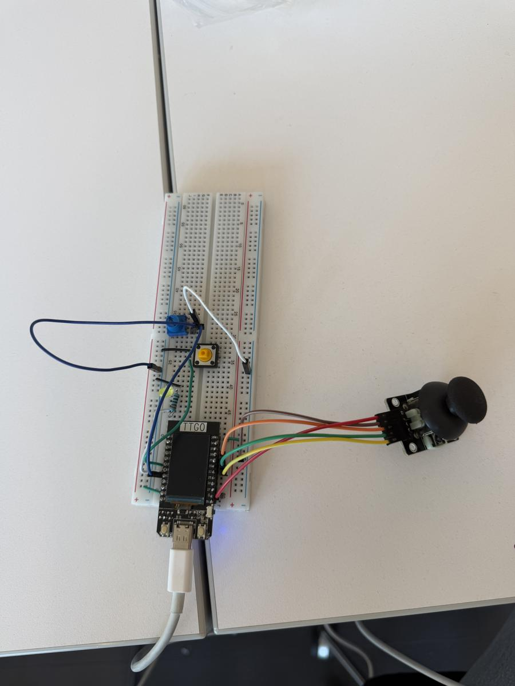
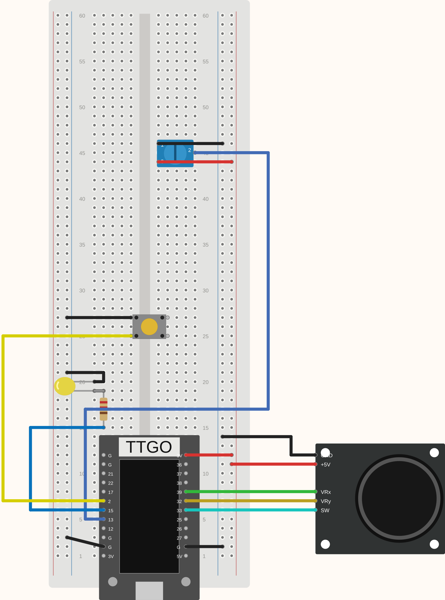

# Your Turn

I’ve danced ballet for 18 years. For this project, I wanted someone who’s never taken a ballet class to be able to make a dance of their own. I gave them two decisions: where should the dancer go, and what should she do when she gets there?

Move the joystick to place the spotlight, turn the knob to choose a plié, turn, or jump, then press the yellow button to try that step. After four choices, the ballerina performs your dance.



[Watch the controller demo and read the project story](https://keira-columbia.github.io/creative-embedded-systems/module-2/#watch-demo)

## Build the controller

**Parts:** Original TTGO T-Display ESP32 with soldered headers, breadboard, jumper wires, analog joystick, three-terminal potentiometer, momentary pushbutton, LED, 220 Ω resistor, and a USB data cable.

<p>
  <a href="media/final-controller.jpg"></a>
  <a href="media/your-turn-circuit.svg"></a>
</p>

Unplug USB before wiring. The photo shows my build; click the diagram to see the connections or [open it in Fritzing](circuit/your-turn.fzz).

| Part | Connect to the ESP32 |
| --- | --- |
| Joystick | VRx → 39, VRy → 32, SW → 33, GND → G. Connect the supply pin labeled +5V to **3V (3.3 V)**. |
| Potentiometer | Terminal 1 → G, terminal 2 (wiper) → 13, terminal 3 → 3V. Put each leg on a separate breadboard strip. |
| Yellow button | Place it across the breadboard gap. Connect two contacts that close when pressed to 2 and G. |
| LED | 15 → 220 Ω resistor → long leg; short leg → G. |

## Run the dance

1. Download the repository. In Arduino IDE, add `https://espressif.github.io/arduino-esp32/package_esp32_index.json` under **Preferences → Additional Boards Manager URLs**. In Boards Manager, install **esp32 by Espressif Systems 2.0.14**.
2. Connect the board by USB. Open [controller.ino](controller/controller.ino), select **ESP32 Dev Module** and the board’s port, then click **Upload**. Close Serial Monitor so Processing can use the port.
3. In Processing 4 (Java mode), open [your_turn.pde](your_turn/your_turn.pde) and click **Run**. The stage appears on your laptop. Once it says **CONTROLLER CONNECTED**, add a step and wait for its preview before adding the next. Press **Esc**, then **Run** for a new dance.

**If the stage says “Waiting for controller”:** The sketch looks for my Mac’s USB port. Add `printArray(Serial.list());` inside `setup()` and run once. In `readController()`, replace `name.startsWith("/dev/cu.wchusbserial")` with `name.equals("COM3")`, substituting the port name printed for your board. Run again.

**No controller?** Press **D** before the first step. Move the mouse to place the spotlight, press **1**, **2**, or **3** to choose a movement, and **Space** to add it.

## How a jump makes it into the dance

Say I put a jump on the left side of the stage, then turn the knob to try a plié on the right. I still want that first jump back when the dance plays. The yellow button is what separates trying out an idea from keeping it. When I press it, [the Processing sketch](your_turn/your_turn.pde) runs this function:

```java
void addStep() {
  if (phase != 0 || count >= 4) return;

  stepX[count] = markerX;
  stepY[count] = markerY;
  stepMove[count] = selected;

  count++;
  phase = 1;
  beginAnimation();
}
```

Those three assignments save the spot and the movement in the same numbered slot. The dancer previews the step right away; the first line keeps another press during that preview from taking up a second slot. After the fourth preview, playback goes back to slot zero and reads the four choices in order.

That distinction mattered for the lighting, too. When I first watched the whole dance, the dancer moved on but the spotlight stayed behind. While I’m choosing a spot, the light belongs under the joystick. During playback, it follows the dancer’s current position, so it travels with her between steps.

Controller adapted from the course’s [Lab 2](https://comsbc3930-fall-2026.notion.site/Lab-2-Breadboarding-Sensing-Serial-Communication-da2350cc6f0583789b5d816f36e83bbe). [AI support note](https://keira-columbia.github.io/creative-embedded-systems/module-2/#ai-support).
