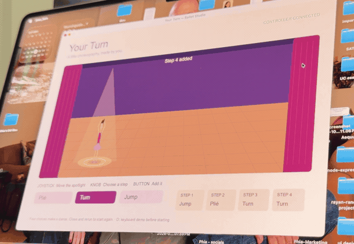
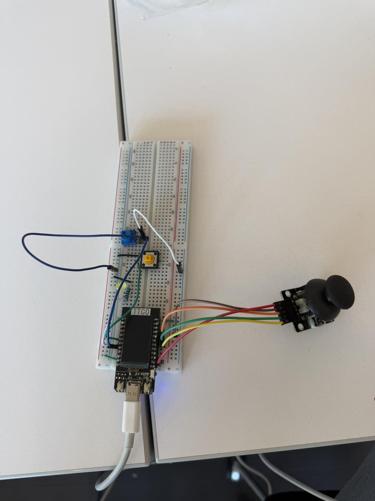
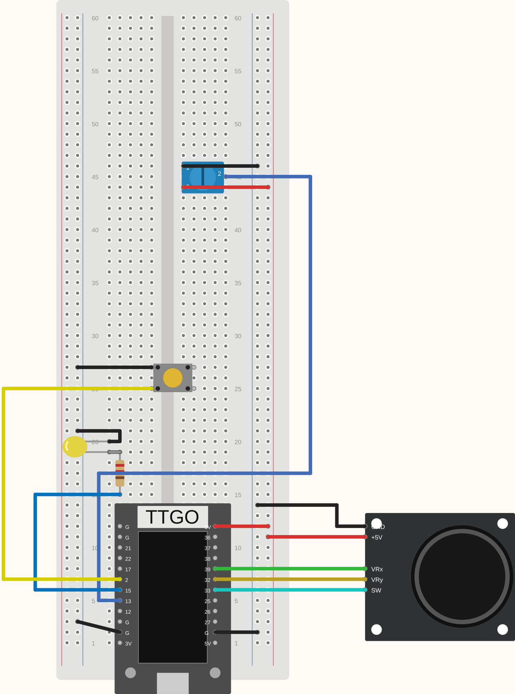

# Your Turn

I have been dancing ballet for 18 years, and I wanted to give someone who has never danced a small way to try choreography. In *Your Turn*, you choose four movements and watch a little ballerina perform them on your laptop. My goal was to make the controls easy to understand after a short explanation.

Move the **joystick** to choose a spot, turn the **potentiometer** to select a plié, turn, or jump, and press the **yellow button** to add it. The dancer previews each choice before performing the whole sequence. The spotlight follows her during playback.

[Read the project story](https://keira-columbia.github.io/creative-embedded-systems/module-2/) for the process, early test videos, and short code explanations.

A short loop from my controller demo, recorded before the later spotlight and full-screen updates. [Watch the demonstration with the physical controls](https://keira-columbia.github.io/creative-embedded-systems/module-2/#watch-demo).

## What you need

- Original ESP32 TTGO T-Display with soldered headers (this build uses the original board, not the S3)
- Breadboard and jumper wires
- Analog joystick module with X, Y, and click outputs
- Three-terminal potentiometer
- Momentary pushbutton
- LED and a 220-ohm resistor
- USB **data** cable and a laptop

I used Arduino IDE **2.3.10**, the Espressif ESP32 board package **2.0.14**, and Processing **4.5.7** in Java mode. Processing's Serial library is included. The dancer is drawn with shapes in code, so there are no sprite files or other assets to download.

## Connect the circuit

Unplug USB while wiring. Follow the pin labels rather than the colors of my wires. Use **3.3V** for both analog controls, including the joystick terminal labeled “+5V.” All grounds connect to the ESP32's **G** pin.

| Component connection | ESP32 connection |
| --- | --- |
| Joystick VRx | 39 |
| Joystick VRy | 32 |
| Joystick SW | 33 |
| Joystick power | 3V |
| Joystick GND | G |
| Potentiometer terminal 1 | G |
| Potentiometer terminal 2 (output/wiper) | 13 |
| Potentiometer terminal 3 | 3V |
| Separate button | Between 2 and G |
| LED anode (long leg) | 15 through the 220-ohm resistor |
| LED cathode (short leg) | G |

Keep the potentiometer's three terminals on separate electrical connections, not in the same connected breadboard row. Place the button across the center gap and use contacts that connect when it is pressed. If you use both sections of a split power rail, bridge them.

The button uses an internal pull-up resistor, so it does not need an external one. The LED lights while you hold the button. The joystick's click is read but does not add steps; that is the separate button's job.

  
  

My finished controller beside its **Fritzing connection diagram**. Click either image to enlarge it. The diagram reconstructs the class Lab 2 arrangement on a longer breadboard like mine: button above the LED and resistor, TTGO below, and joystick beside it. I added the potentiometer above the button, with its output on **13** and its other terminals on **3V** and **G**. It uses custom drawn parts; wire colors and exact hole positions may differ from my photo. Follow the pin labels and table above when rebuilding.

[Download the editable Fritzing file](circuit/your-turn.fzz).

## Upload the ESP32 program

1. Download this repository and keep the sketch folders intact.
2. In Arduino IDE's preferences, add this to **Additional Boards Manager URLs**: `https://espressif.github.io/arduino-esp32/package_esp32_index.json`.
3. In Boards Manager, install **esp32 by Espressif Systems**, version **2.0.14**.
4. Connect USB and open [controller/controller.ino](controller/controller.ino). Select **ESP32 Dev Module** and your board's port under **Tools → Port**, then click Upload.
5. Close Serial Monitor before opening the laptop sketch. Only one program should use the serial port at a time.

The board reads the controls and sends a line of five numbers about every 50 milliseconds: `x,y,joystickClick,knob,button`. Both programs use **9600 baud**. Pressed buttons read `0`; released buttons read `1`. Leave Wi-Fi off because pin 13 uses the ESP32's ADC2.

## Open the stage

Open [your_turn/your_turn.pde](your_turn/your_turn.pde) in Processing and click **Run**. Wait for **CONTROLLER CONNECTED** before trying the controls. USB supplies power, and the ESP32 screen stays blank—the stage is on the laptop.

My Mac's port starts with `/dev/cu.wchusbserial`, which the sketch finds automatically. If yours has a different name:

1. Add `printArray(Serial.list());` inside `setup()` and run once to see the available ports in Processing's console.
2. In `readController()`, replace `name.startsWith("/dev/cu.wchusbserial")` with `name.equals("YOUR_PORT")`, using the exact name from your computer, such as `COM3` or `/dev/ttyUSB0`.
3. Stop and run again.

Wait for each preview to finish before adding the next step. After four steps, the complete dance plays. Press **Esc** to close the full-screen stage, then **Run** to start again. The dance is kept in memory only; it is not saved between runs. The ESP32 keeps its uploaded program when unplugged.

To try the visuals without hardware, press **D** before adding any steps. Move the mouse to position the spotlight, use **1 / 2 / 3** to choose a movement, and **Space** to add it.

## If something is not responding

- **Waiting for controller:** check the USB data cable and port name, and close other serial programs. A power light does not necessarily mean the data connection is working.
- **Knob does nothing:** check its output is on **13**, matching the code, with power and ground on the other terminals.
- **Joystick stays at an edge:** check 39, 32, power, and ground. The code expects a resting value near 2048 and ignores small changes around that center.
- **Button will not add a step:** wait for the preview to end. After four choices, close and rerun to start a new dance.

## Starting point

The controller builds on our course's [Lab 2: Breadboarding, Sensing, & Serial Communication](https://comsbc3930-fall-2026.notion.site/Lab-2-Breadboarding-Sensing-Serial-Communication-da2350cc6f0583789b5d816f36e83bbe). The [proposal](proposal.html) records the original plan; the [blog](https://keira-columbia.github.io/creative-embedded-systems/module-2/) describes how the project developed.

## AI support

The [note at the end of my blog](https://keira-columbia.github.io/creative-embedded-systems/module-2/#ai-support) describes the OpenAI support, model, and example prompts used for this project.
