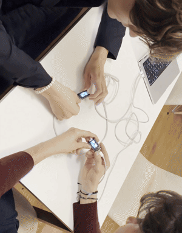

# Row Together · Beat the Tide

Two people hold opposite oars of the same boat. We remixed a competitive button masher so that getting to the island depends on noticing when your partner presses. Each player holds one ESP32. Both see the same distance and race clock.

## Get the sketches

[Download the course repository as a ZIP](https://github.com/keira-columbia/creative-embedded-systems/archive/refs/heads/main.zip), unzip it, and open the `module-3` folder. Keep each sketch in its own folder. The left board runs the race clock and counts points. The right board sends its player’s tap time to the left and displays the shared score.

## Build it

1. Get two original LilyGO/TTGO T-Display ESP32 boards with the 240 × 135 screen and two USB data cables. The buttons and screens are built in.
2. In Arduino IDE, install **esp32 by Espressif Systems** in Boards Manager and **TFT_eSPI by Bodmer** in Library Manager. The project uses ESP32 core **2.0.14** and TFT_eSPI **2.5.43**. If the board package is missing, add the [Espressif package index](https://espressif.github.io/arduino-esp32/package_esp32_index.json) in Preferences → Additional Boards Manager URLs.
3. Open the installed library’s `TFT_eSPI/User_Setup_Select.h`. Enable `#include <User_Setups/Setup25_TTGO_T_Display.h>` as the only active display setup. Select **ESP32 Dev Module** in the IDE.
4. Plug in the first board, choose its USB port, and upload [LeftOar.ino](LeftOar/LeftOar.ino). Repeat with the second board and [RightOar.ino](RightOar/RightOar.ino). Once both uploads finish, power both boards. The game starts automatically each time you plug them in. The screens should say **LEFT OAR** and **RIGHT OAR**. They find each other over ESP-NOW. If several crews play nearby, give each pair its own matching `TEAM` value in both sketches.

## Play one round

Tap either front button on **each board** to ready up. After the shared countdown, tap once each time the beat bar refills. A solo tap earns zero. Two taps in the same beat earn **+1**, or **+2** if they land within **180 ms**. After three +1s, the next point requires a synchronized pair. Reach **19 spaces in 12 beats (18 seconds)**. At the replay prompt, one press on either board starts another countdown.

## Check the connection

When both players press Ready, both screens should start the same three-second countdown. Try one beat with just one player tapping. The oar should swing and the score should stay put. On the next beat, count aloud and tap together. If the taps land within 180 ms, both screens should show **IN SYNC +2**.

If a screen stays on **Waiting for other board**, check the role labels first. You should have one **LEFT OAR** and one **RIGHT OAR**. If both labels match, upload the other sketch to one board. If the roles are correct, check that both sketches have the same `TEAM` number.

[Watch the two-player demo and read Kira’s design notes](https://keira-columbia.github.io/creative-embedded-systems/module-3/?v=boat-views-2) · [Professor Tseng’s starter sketch](https://github.com/ttseng/bccoms3930-module-3)

[Compare the original side view and the final view from the boat](https://keira-columbia.github.io/creative-embedded-systems/module-3/?v=boat-views-2#boat-views)
